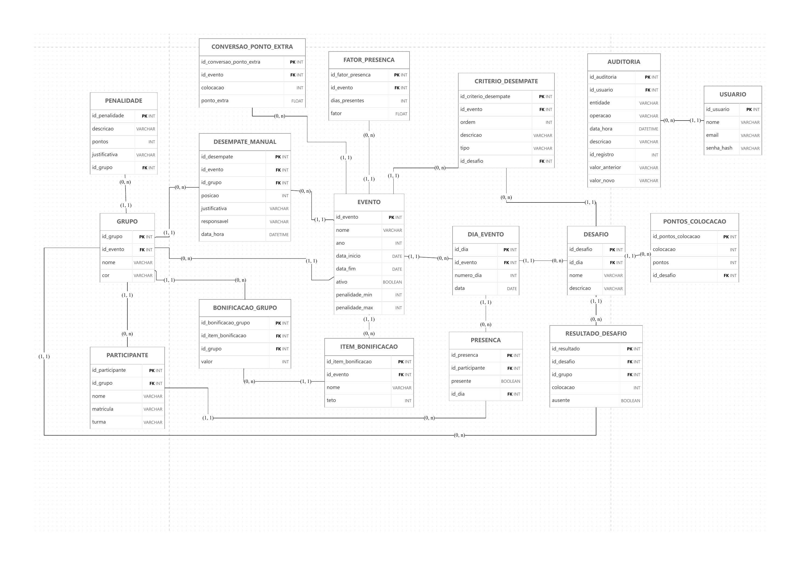

# EventScore

O EventScore é um sistema para organizar e apurar resultados de eventos com desafios em grupo. Cada evento poderá configurar seus dias, grupos, desafios e regras de pontuação. A aplicação calculará a classificação dos grupos e a pontuação individual dos participantes.

Este repositório contém o backend e a API.

## Stack

- **Runtime e linguagem:** Node.js 24 e TypeScript (ES Modules)
- **Framework:** NestJS 12
- **Banco de dados:** PostgreSQL 18, via Docker Compose
- **ORM e migrações:** Prisma 7
- **Validação de ambiente:** Zod
- **Testes:** Vitest e Supertest
- **Qualidade:** oxlint, Prettier e GitHub Actions
- **Documentação da API:** OpenAPI/Swagger (planejado)

## Pré-requisitos

- [Node.js 24](https://nodejs.org/). Recomendado instalar via [nvm](https://github.com/nvm-sh/nvm), que lê a versão do arquivo `.nvmrc`
- [Docker](https://docs.docker.com/get-docker/) com Docker Compose
- Git

## Como rodar

```bash
# 1. Clonar e entrar no projeto
git clone git@github.com:hanrrysantos/event-score.git
cd event-score

# 2. Usar a versão correta do Node
nvm use

# 3. Instalar as dependências (também gera o Prisma Client)
npm ci

# 4. Criar o arquivo de ambiente local
cp .env.example .env

# 5. Subir o PostgreSQL
docker compose up -d

# 6. Iniciar a API (aplica migrações pendentes e recarrega ao salvar)
npm run start:dev
```

Para conferir se está tudo funcionando:

```bash
curl localhost:3000/health
# {"status":"ok","info":{"database":{"status":"up"}},...}
```

### Depois de um `git pull`

Basta rodar `npm run start:dev` de novo: migrações novas são aplicadas e o Prisma Client é regenerado automaticamente. Se o `package-lock.json` mudou, rode `npm ci` antes.

## Scripts

| Script | O que faz |
|---|---|
| **Execução** | |
| `npm run start:dev` | Aplica migrações, gera o Prisma Client e inicia com recarga automática |
| `npm run start:debug` | Igual ao anterior, com o depurador do Node habilitado |
| `npm run build` | Compila para `dist/` |
| `npm run start:prod` | Executa a versão compilada (não aplica migrações) |
| **Qualidade** | |
| `npm run lint` | Verifica o código com oxlint |
| `npm run typecheck` | Verifica os tipos de todo o projeto, inclusive testes |
| `npm run format` | Formata o código com Prettier |
| `npm run format:check` | Verifica a formatação sem alterar arquivos |
| **Testes** | |
| `npm test` | Testes unitários |
| `npm run test:watch` | Testes unitários em modo observação |
| `npm run test:cov` | Testes unitários com relatório de cobertura |
| `npm run test:e2e` | Testes e2e (exigem o PostgreSQL rodando) |
| **Banco de dados** | |
| `npm run db:migrate` | Cria uma migração a partir de mudanças no `schema.prisma` e aplica |
| `npm run db:deploy` | Aplica migrações pendentes |
| `npm run db:generate` | Gera o Prisma Client |
| `npm run db:studio` | Abre uma interface web para ver e editar os dados |

## Variáveis de ambiente

Definidas no `.env` (copiado de `.env.example`, nunca versionado). A aplicação valida as variáveis ao iniciar e não sobe se alguma estiver inválida.

| Variável | Usada por | Descrição |
|---|---|---|
| `NODE_ENV` | API | `development`, `test` ou `production` (padrão: `development`) |
| `PORT` | API | Porta HTTP (padrão: `3000`) |
| `DATABASE_URL` | API e Prisma | URL de conexão com o PostgreSQL |
| `POSTGRES_USER` | Compose | Usuário do banco |
| `POSTGRES_PASSWORD` | Compose | Senha do banco |
| `POSTGRES_DB` | Compose | Nome do banco |
| `POSTGRES_PORT` | Compose | Porta exposta na sua máquina (padrão: `5432`) |

`DATABASE_URL` deve usar o mesmo usuário, senha, porta e banco das variáveis `POSTGRES_*`.

## Estrutura

```
├── .github/workflows/   # Pipeline de CI
├── docs/
│   └── adr/             # Registros de decisões técnicas
├── prisma/
│   ├── schema.prisma    # Esquema do banco (fonte de verdade)
│   └── migrations/      # Migrações SQL versionadas
├── src/
│   ├── main.ts          # Ponto de entrada
│   ├── app.module.ts    # Módulo raiz
│   ├── config/          # Validação das variáveis de ambiente
│   ├── prisma/          # PrismaService (acesso ao banco)
│   ├── health/          # GET /health
│   ├── modules/         # Módulos de domínio (eventos, grupos...)
│   └── generated/       # Prisma Client gerado (não versionado)
└── test/                # Testes e2e
```

## Contribuindo

Fluxo de trabalho, convenções de código, testes e migrações estão em [CONTRIBUTING.md](CONTRIBUTING.md).

## Decisões técnicas

As decisões de arquitetura ficam registradas em [`docs/adr/`](docs/adr/):

- [ADR 0001: Prisma como ORM e estratégia de migrações](docs/adr/0001-orm-prisma.md)

## Modelo de dados

DER preliminar, sujeito a alterações.

<p align="center">
  
</p>
